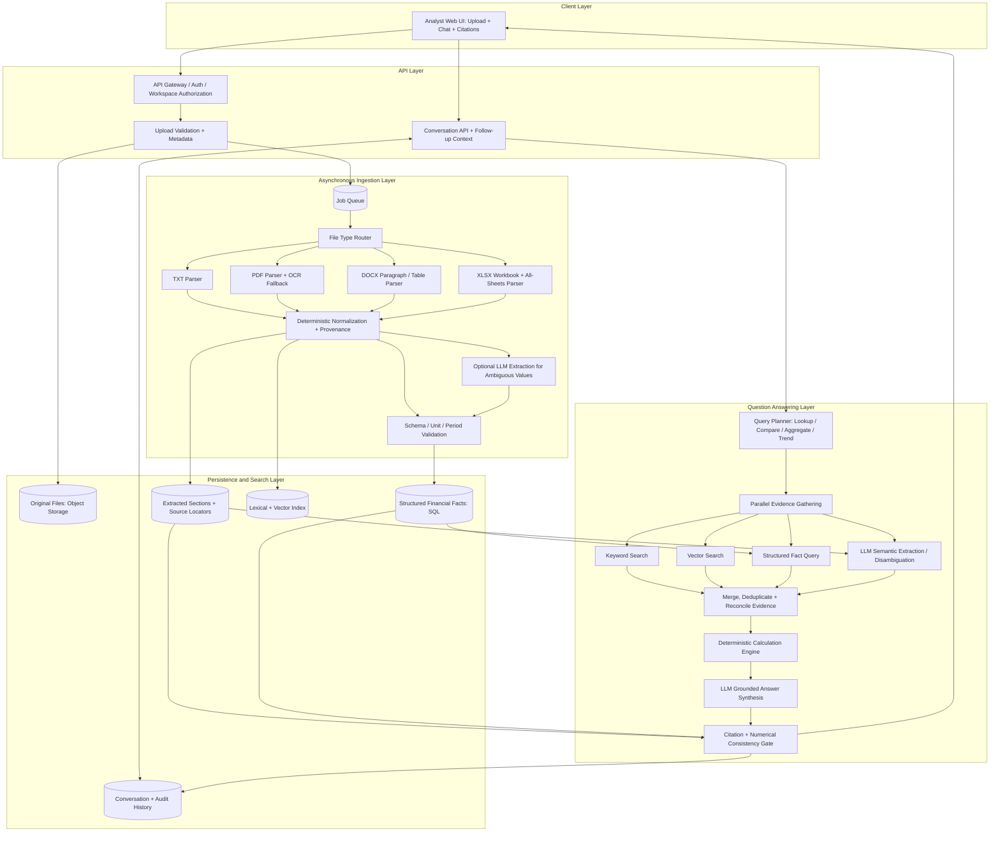

# Multi-Document Financial Analysis Assistant
## System Architecture & Implementation Plan

**Status:** Proposed  
**Document type:** Technical design / implementation plan  
**Primary goal:** Let an investment analyst upload financial documents for multiple companies and ask cross-document questions with verifiable, source-grounded answers.

---

## 1. Problem Statement

Analysts commonly review earnings reports, investor presentations, annual filings, and spreadsheets separately, then manually consolidate financial metrics. This is slow, error-prone, and difficult to audit.

The system should allow an analyst to:

- Upload multiple documents for different companies and reporting periods.
- Accept `.txt`, `.pdf`, `.docx`, and `.xlsx` files, including Excel workbooks with multiple sheets.
- Ask questions across the complete uploaded collection, including comparisons and aggregations.
- Ask contextual follow-up questions without repeating the company or metric names.
- Verify each material claim through a citation to the source document and, where possible, a page, section, worksheet, or cell range.
- See when data is missing, ambiguous, inconsistent, or not comparable rather than receiving a fabricated answer.

## 2. Goals and Non-Goals

### Goals

1. Reliable multi-format ingestion and text/data extraction.
2. Cross-document retrieval and synthesis.
3. Structured financial calculations for comparisons and totals.
4. Claim-level citations with precise source locations.
5. Conversational context for follow-up questions.
6. Secure document handling, auditability, and observable processing.

### Initial non-goals

- Live market data or external financial-data-provider integration.
- Investment recommendations or automated buy/sell decisions.
- Replacing an analyst's accounting judgment.
- Perfect extraction from every scanned, handwritten, or malformed document.
- Treating generated LLM text as an authoritative source of numerical truth.

## 3. Core Design Principles

- **Evidence before answer:** every material factual claim must be supported by retrieved evidence.
- **Calculate, don't guess:** use deterministic code for arithmetic, growth rates, totals, and comparisons.
- **Preserve provenance:** keep the original file and source locators throughout ingestion, indexing, extraction, and response generation.
- **Separate narrative from facts:** use the LLM to interpret and explain evidence; use validated structured values and code for calculations.
- **Make uncertainty explicit:** disclose missing periods, unit mismatches, conflicting values, and low-confidence extraction.
- **Isolate workspaces:** documents from one user or workspace must not leak into another.

## 4. High-Level Design (HLD)

The system follows a **deterministic-first, LLM-assisted** design. Standard file parsing, known-pattern extraction, schema validation, normalization, calculations, ranking, and citation checks use deterministic code. LLM calls are reserved for ambiguous narrative, varied labels, complex table interpretation, and patterns that are difficult to express reliably as rules. Independent extraction and retrieval tasks run concurrently; their outputs are reconciled before any answer is generated.

### 4.1 HLD diagram — components and data flow



### 4.2 Request lifecycle

1. **Upload:** validate the file and authorization, store the original, record company/period metadata, and enqueue processing.
2. **Extract:** route each file to its format-specific parser. Parse Excel sheet-by-sheet, retaining worksheet names and cell ranges. Use OCR only when PDF text extraction is insufficient.
3. **Normalize deterministically:** normalize encodings, dates, currencies, units, and known metric aliases while preserving raw values and source locators.
4. **Use LLM selectively:** invoke an LLM only for ambiguous labels, irregular narrative disclosures, complex table interpretation, or extraction candidates that rules cannot confidently resolve.
5. **Validate and persist:** validate LLM outputs against a strict schema; store raw value, normalized value, unit, period, confidence, evidence excerpt, and source locator. Low-confidence or conflicting candidates require review or explicit caveats.
6. **Plan the question:** classify the query as lookup, comparison, aggregation, trend, or clarification.
7. **Gather evidence in parallel:** execute lexical retrieval, vector retrieval, structured-fact queries, and—when needed—LLM-based semantic extraction concurrently.
8. **Merge and calculate:** deduplicate evidence, reconcile aliases and units, detect conflicts, and calculate totals/growth/rankings using deterministic code.
9. **Synthesize and gate:** ask the LLM to explain only the approved evidence and computed outputs; validate claim-level citations and numerical consistency before returning the answer.

### 4.3 Parallel execution with LangChain concepts

Use LangChain's runnable composition concepts rather than serially calling every subsystem. `RunnableParallel` is appropriate for independent retrieval/extraction branches; `RunnablePassthrough.assign` can carry the original query and resolved conversation state alongside branch results; `RunnableLambda` can wrap deterministic Python functions; and `RunnableBranch` can route between lookup, comparison, aggregation, and clarification workflows. A queue/worker system remains responsible for long-running document ingestion; LangChain runnables orchestrate per-request work, not durable job scheduling.

Illustrative orchestration (conceptual pseudocode; adapt imports and APIs to the installed LangChain version):

```python
from langchain_core.runnables import RunnableLambda, RunnableParallel, RunnablePassthrough

parallel_evidence = RunnableParallel({
    "keyword_hits": keyword_retriever,
    "vector_hits": vector_retriever,
    "structured_facts": RunnableLambda(fetch_matching_financial_facts),
    # Include only when the query/document needs semantic value extraction.
    "semantic_candidates": RunnableLambda(extract_ambiguous_candidates),
})

answer_chain = (
    RunnablePassthrough.assign(evidence=parallel_evidence)
    | RunnableLambda(merge_deduplicate_and_validate_evidence)
    | RunnableLambda(run_deterministic_calculations)
    | grounded_answer_llm
    | RunnableLambda(validate_claims_and_citations)
)
```

**Important implementation notes:**

- Parallel branches should have timeouts, bounded concurrency, retries for transient failures, and clear partial-failure behavior.
- Do not run an LLM extraction branch for every query by default; route to it only when deterministic parsing or retrieved evidence is insufficient.
- Keep deterministic calculation functions pure and independently unit-tested.
- Return typed outputs from each branch, including provenance and confidence—not unstructured prose alone.
- If a required branch fails, either return a clearly marked partial result or ask the user to retry; never silently treat a failed branch as “no data.”
- Ensure every branch applies the same workspace/document authorization filters.

### 4.4 Deterministic-first decision policy

| Situation | Preferred path | LLM involvement |
|---|---|---|
| Known format and ordinary text/table extraction | Parser and rules | None unless extraction is poor or ambiguous |
| Metric label matches a controlled dictionary | Alias mapping and schema validation | Optional fallback for unknown labels |
| Financial values, units, dates, percentages | Deterministic parsing and validation | Resolve ambiguity only; retain source text |
| Complex narrative disclosure or irregular table | Retrieve source section, then structured LLM extraction | Yes, with schema-constrained output |
| Total, growth rate, ranking, margin calculation | Deterministic calculation engine | Explain the result after calculation |
| Conflicting sources or non-comparable periods | Rules detect conflict and mark uncertainty | May summarize the conflict, never silently choose a value |
| Final natural-language response | Grounded synthesis from approved evidence | Yes, with citations validated after generation |

### Main components

1. **Analyst UI:** upload files, view processing status, select a workspace/document collection, chat, and inspect citations.
2. **API and authentication:** validates users, permissions, upload size/type, and document metadata.
3. **Original file store:** stores uploaded bytes immutably, with encryption and access controls.
4. **Job queue and ingestion workers:** process larger files asynchronously and support retries.
5. **Format-specific extractors:** parse text, PDF pages, Word paragraphs/tables, and every worksheet in Excel workbooks.
6. **Document/provenance store:** persists extracted text, file metadata, processing state, and source locators.
7. **Financial fact extraction:** identifies candidate metrics and values, normalizes units and periods, and records evidence.
8. **Relational financial facts store:** supports precise filters, comparisons, totals, and time-series calculations.
9. **Hybrid search index:** combines keyword search and vector similarity, filtered by workspace and selected documents.
10. **Query and conversation service:** resolves follow-ups, retrieves evidence, and chooses retrieval-only or calculation-backed workflows.
11. **Calculation engine:** performs arithmetic using validated, normalized values.
12. **Grounded answer synthesis and validation:** drafts an answer from evidence and verifies that citations exist and support the claims.

## 5. Document Ingestion Pipeline

### 5.1 Upload contract

For each upload, capture:

- `document_id`
- `workspace_id`
- Original filename and detected MIME type
- File size and checksum
- Optional company name/ticker
- Optional reporting period and document type
- Uploading user and timestamp
- Processing status and error details

Company and period metadata should be editable by the analyst. Do not assume a filename alone reliably identifies the company or reporting period.

### 5.2 Format support

| Format | Extraction strategy | Provenance to preserve | Important considerations |
|---|---|---|---|
| `.txt` | Decode text with encoding detection and safe fallback | Line ranges or character offsets | Handle encoding issues and very large files |
| `.pdf` | Extract page text and layout; OCR fallback for scanned pages | Page number, section heading, bounding box when available | Detect low-text pages; tables may need specialized extraction |
| `.docx` | Parse paragraphs, headings, tables, and document order | Heading path, paragraph index, table/row/cell coordinates | Preserve table structure rather than flattening everything |
| `.xlsx` | Open workbook and iterate through every worksheet | Workbook, sheet name, cell range, row/column, cell address | Preserve formulas and cached values where available; distinguish blank, zero, and missing |

For `.xlsx`, process hidden sheets too, but mark them as hidden metadata so the UI can make their inclusion transparent. Preserve sheet names and cell coordinates. Never treat a spreadsheet's formula string as the computed value unless the formula can be evaluated or a valid cached result is available.

### 5.3 Extraction stages

1. Validate extension, MIME type, file size, and file signature.
2. Scan for malware where infrastructure supports it.
3. Store original file and checksum.
4. Dispatch asynchronous extraction job.
5. Extract text, tables, and structural locations.
6. Normalize whitespace and encoding while preserving source offsets.
7. Detect pages/sheets with poor or empty extraction.
8. Save normalized content and provenance.
9. Create chunks for search and embeddings.
10. Extract candidate financial facts into structured records.
11. Run validation checks and mark the document ready, partially ready, or failed.

### 5.4 Processing states

`uploaded → queued → extracting → indexing → ready`

Alternative terminal/intermediate states: `partially_ready`, `failed`, `needs_review`.

The UI should show per-file progress and useful errors. Retrying a job must be idempotent so the same document does not create duplicate facts or chunks.

## 6. Data Model

A relational database such as PostgreSQL is a suitable source of truth for metadata, conversations, financial facts, and citations.

### 6.1 Suggested tables

#### `workspaces`
- `id`
- `name`
- `owner_user_id`
- `created_at`

#### `documents`
- `id`
- `workspace_id`
- `company_name`
- `ticker` (nullable)
- `reporting_period_start` / `reporting_period_end` (nullable)
- `document_type` (annual filing, earnings report, investor deck, spreadsheet, other)
- `filename`
- `mime_type`
- `checksum`
- `storage_key`
- `status`
- `created_at`

#### `document_sections`
- `id`
- `document_id`
- `section_title` (nullable)
- `content_text`
- `page_number` (nullable)
- `sheet_name` (nullable)
- `cell_range` (nullable)
- `paragraph_start` / `paragraph_end` (nullable)
- `char_start` / `char_end` (nullable)
- `content_type` (paragraph, table, worksheet range, OCR text, etc.)
- `metadata_json`

#### `document_chunks`
- `id`
- `document_id`
- `section_id`
- `chunk_index`
- `chunk_text`
- `token_count`
- `embedding_ref` or embedding vector
- `metadata_json`

#### `financial_facts`
- `id`
- `workspace_id`
- `document_id`
- `company_name`
- `metric_name` (canonical metric)
- `raw_metric_name`
- `value_numeric` (nullable)
- `value_text` (nullable)
- `currency` (nullable)
- `unit` (currency, percent, shares, multiple, etc.)
- `period_start` / `period_end`
- `period_type` (quarter, fiscal year, trailing twelve months, point-in-time)
- `scope` (consolidated, segment, geography, etc.)
- `source_section_id`
- `source_locator` (page, section, sheet/cells)
- `extraction_method`
- `confidence`
- `validation_status`
- `created_at`

#### `conversations`
- `id`
- `workspace_id`
- `user_id`
- `created_at`

#### `messages`
- `id`
- `conversation_id`
- `role`
- `content`
- `resolved_query` (nullable)
- `created_at`

#### `answer_claims`
- `id`
- `message_id`
- `claim_text`
- `claim_type` (fact, calculation, interpretation)
- `validation_status`

#### `claim_citations`
- `id`
- `claim_id`
- `document_id`
- `section_id` (nullable)
- `financial_fact_id` (nullable)
- `source_locator`
- `quoted_evidence` (short excerpt)
- `relevance_score` (nullable)

### 6.2 Canonical metric normalization

Create a metric dictionary with aliases and definitions, for example:

- `revenue`: sales, total revenue, net revenue (only where definitions are compatible)
- `arr`: annual recurring revenue
- `gross_margin_pct`
- `operating_margin_pct`
- `net_income`
- `ebitda`
- `free_cash_flow`
- `customer_count`

Do not merge terms just because they look similar. For example, ARR and recognized revenue are different concepts; EBITDA and operating income are not interchangeable. Keep the raw label alongside the canonical metric.

## 7. Retrieval and Question Answering

### 7.1 Query flow

1. Receive the user's question and conversation ID.
2. Resolve references such as “they,” “those companies,” or “what about margins?” using recent chat context.
3. Identify the requested companies, metrics, periods, comparison, and calculation.
4. Choose the appropriate workflow:
   - **Lookup:** retrieve evidence for a direct question.
   - **Comparison:** retrieve comparable facts for multiple companies.
   - **Aggregation:** retrieve values and calculate a sum or other aggregate.
   - **Trend:** retrieve facts across periods and calculate changes.
   - **Clarification:** ask a question if company, period, units, or metric definitions are ambiguous.
5. Run hybrid retrieval across all in-scope documents: keyword search plus vector search, with metadata filters.
6. Retrieve neighboring chunks or full table context when a result depends on nearby rows/columns.
7. Extract candidate facts and source locators.
8. Validate consistency, units, currency, fiscal period, consolidation scope, and duplicates.
9. Use deterministic code for arithmetic.
10. Ask the LLM to explain only the validated evidence and computed results.
11. Validate each material claim and citation before returning the answer.
12. Persist the response and citations in conversation history.

### 7.2 Hybrid retrieval

Use both:

- **Lexical search** for exact metric labels, company names, financial terms, and figures.
- **Vector search** for semantically similar passages and paraphrased questions.
- **Metadata filters** for workspace, selected document set, company, reporting period, document type, and source type.
- **Reranking** where needed to prioritize passages that directly answer the question.

Do not rely on vector search alone for exact financial values or spreadsheet lookups.

### 7.3 Structured calculations

For questions such as “Which company has the highest revenue growth?”:

1. Identify the exact metric and comparable periods.
2. Retrieve current and prior-period revenue for every company.
3. Verify that all values use compatible currency, period duration, and accounting scope.
4. Calculate growth in code:

   `growth_pct = ((current_revenue - prior_revenue) / prior_revenue) * 100`

5. Handle zero or negative prior-period values explicitly; do not silently produce misleading percentages.
6. Rank only companies with sufficient comparable data.
7. Cite both the current and prior-period source values for every comparison.

For “What is the total combined ARR?”:

1. Retrieve ARR for each included company as of a compatible date.
2. Confirm values are ARR, not recognized revenue or bookings.
3. Normalize currency if a documented conversion rate and date are available; otherwise ask the analyst or report separate currencies.
4. Deduplicate repeated facts from multiple documents.
5. Sum values with deterministic code.
6. Show the included companies, individual values, currency, date basis, and citations.

### 7.4 Handling ambiguity and conflicts

- If two documents disagree, show both values and their source locations.
- Prefer neither source automatically unless a transparent rule is configured (e.g., audited annual filing over a preliminary presentation for a specified metric).
- Ask for clarification when fiscal years, currencies, segments, or metric definitions are not comparable.
- Label extracted values with low confidence and offer the source excerpt.
- Distinguish `0`, missing, not disclosed, not applicable, and extraction failure.

## 8. Citation and Answer Design

Citations are a core requirement, not a UI enhancement.

### 8.1 Citation granularity

- PDF: filename, page, section heading where available.
- DOCX: filename, heading path, paragraph or table location.
- XLSX: workbook, worksheet name, and cell/range (e.g., `FY2025!B12:C12`).
- TXT: filename, line range or character offsets.
- OCR: page number and, where available, bounding box.

### 8.2 Claim-level evidence

Each factual sentence should link to one or more citations. A calculated claim should cite every source value used in the calculation. Interpretive claims should cite the passages that support the interpretation.

Example answer format (illustrative only):

> **Company B had the highest year-over-year revenue growth at 18%.** This compares FY2025 revenue with FY2024 revenue using the same reporting basis. [Company B FY2025 filing, p. 12] [Company B FY2024 filing, p. 10]

The UI should open a citation drawer showing:

- Source filename and company
- Page, section, sheet, or cell range
- Exact supporting excerpt or table row
- Extracted value and normalized value, if relevant
- Any caveat or confidence warning

### 8.3 Validation rules

Before displaying an answer:

- Every citation must point to a real stored source location.
- Every calculation must be reproducible from stored inputs.
- Every numerical claim must match the computed result or cited value.
- A claim without evidence should be removed, qualified, or marked as unsupported.
- Do not fabricate page numbers, sheet names, or quotes.

## 9. Conversation and Follow-Up Questions

Persist the full conversation, but do not blindly append the entire chat to every prompt.

For each new turn:

1. Resolve the current question against recent messages.
2. Maintain a compact conversation state: active companies, reporting periods, selected document set, canonical metrics, and unresolved assumptions.
3. Rewrite contextual questions into a standalone internal query.
4. Show the interpretation when it could be ambiguous.

Example:

- User: “Which company has the highest revenue growth?”
- Assistant: answers with company and periods.
- User: “What about their margins?”
- Internal resolved query: “Compare gross, operating, and net margins for the companies in the prior comparison over the same reporting period, using the uploaded documents.”

If “their” could refer to multiple entities or “margins” could mean several metrics, ask a concise clarifying question instead of guessing.

## 10. Deterministic + LLM Extraction Contract

The extraction layer should produce a common typed record regardless of whether the candidate came from rules, a parser, or an LLM. The LLM is a candidate extractor, not the source of truth.

Example normalized record:

```json
{
  "company_name": "Example Co",
  "metric_name": "revenue",
  "raw_metric_name": "Total net sales",
  "raw_value": "USD 4.2 billion",
  "value_numeric": 4200000000,
  "currency": "USD",
  "unit": "currency",
  "period_start": "2025-01-01",
  "period_end": "2025-12-31",
  "period_type": "fiscal_year",
  "scope": "consolidated",
  "source": {
    "document_id": "doc_123",
    "page_number": 18,
    "section_title": "Financial Results",
    "sheet_name": null,
    "cell_range": null,
    "quoted_evidence": "Total net sales were USD 4.2 billion..."
  },
  "extraction_method": "llm_assisted",
  "confidence": 0.91,
  "validation_status": "needs_comparability_check"
}
```

The values above are illustrative. In production, validate this object with a strict Pydantic/JSON schema. Never accept a value without a source locator and supporting excerpt. Preserve the original textual value even after normalization. Confidence should be calibrated against an evaluation dataset rather than treated as a probability merely because the model emitted a number.

### Extraction and reconciliation rules

1. Run deterministic parser/rule extraction first.
2. Identify missing, ambiguous, conflicting, or low-confidence candidate facts.
3. Send only the relevant source passages/table region to the LLM, requesting structured output with the source locator supplied by the application.
4. Validate the output schema and confirm the cited excerpt exists in the stored source.
5. Apply deterministic unit, currency, period, scope, range, and alias checks.
6. Merge exact duplicates while retaining all supporting source references.
7. Keep conflicts as competing candidates until an explicit precedence policy or analyst decision resolves them.
8. Make validated facts available to SQL calculations and search; do not let generated answer prose write directly into the facts table.

---

## 11. Suggested Technology Choices

These are replaceable implementation choices, not hard requirements.

| Layer | Suggested option | Rationale |
|---|---|---|
| Frontend | React / Next.js | File upload, chat, citations, processing status |
| API | Python FastAPI | Good ecosystem for document parsing and AI workflows |
| Background jobs | Celery or RQ with Redis; alternatively a managed queue | Async extraction, retries, backpressure |
| Relational database | PostgreSQL | Metadata, conversations, facts, audit trail |
| Object storage | S3-compatible storage | Original files and extracted artifacts |
| Full-text search | PostgreSQL full-text search or OpenSearch | Exact terms and keyword matching |
| Vector search | pgvector or a dedicated vector database | Semantic retrieval |
| Parsing | PyMuPDF/pdfplumber, python-docx, openpyxl | Format-specific extraction |
| OCR | Tesseract or a managed OCR service | Scanned PDF fallback |
| LLM | Provider-agnostic model adapter | Query understanding and evidence-grounded synthesis |
| Embeddings / reranker | Configurable model services | Semantic retrieval and relevance ranking |
| Observability | Structured logs, metrics, traces, error tracking | Debugging and reliability |

**MVP recommendation:** start with FastAPI, PostgreSQL + pgvector, object storage, a Redis-backed job queue, and format-specific Python parsers. Add a dedicated search service or managed OCR only when quality or scale requires it.

## 12. API Sketch

Illustrative endpoints:

- `POST /api/workspaces/{workspace_id}/documents` — upload a document and metadata.
- `GET /api/workspaces/{workspace_id}/documents` — list documents and processing states.
- `GET /api/documents/{document_id}` — inspect status, metadata, and extraction diagnostics.
- `DELETE /api/documents/{document_id}` — remove a document and its derived artifacts according to retention policy.
- `POST /api/workspaces/{workspace_id}/conversations` — create a conversation.
- `POST /api/conversations/{conversation_id}/messages` — ask a question and receive a grounded answer.
- `GET /api/messages/{message_id}/citations` — retrieve claim citations and source locators.
- `POST /api/documents/{document_id}/retry` — retry recoverable processing failures.

For large files, use direct-to-object-storage uploads or resumable upload support. Enforce authorization at every endpoint and on every retrieval query.

## 13. Security, Privacy, and Reliability

- Encrypt files and databases at rest and use TLS in transit.
- Enforce tenant/workspace filtering in relational, lexical, and vector retrieval.
- Validate file signatures and MIME types; limit size and decompression ratios.
- Treat document content as untrusted data, not instructions. Defend against prompt injection embedded in uploaded files.
- Never allow document text to override system policies or trigger tools by itself.
- Avoid sending unnecessary sensitive content to external model providers; configure retention and processing policies deliberately.
- Keep an audit trail of uploads, deletions, queries, calculations, and citations.
- Apply rate limits, quotas, timeouts, retry policies, and dead-letter handling.
- Ensure deletion removes originals and all derived text, chunks, embeddings, and facts according to the retention policy.
- Back up critical metadata and test restore procedures.
- Make ingestion and indexing idempotent.
- Use least-privilege service credentials and secrets management.

## 14. Evaluation and Acceptance Criteria

Build a representative test set with known answers, source locations, spreadsheet edge cases, and deliberately conflicting documents.

### Functional acceptance criteria

- [ ] Accept `.txt`, `.pdf`, `.docx`, and `.xlsx`.
- [ ] Extract all worksheets in an `.xlsx` workbook and preserve sheet/cell locations.
- [ ] Detect scanned PDFs and invoke OCR fallback where enabled.
- [ ] Display processing status and extraction errors per document.
- [ ] Search across all documents authorized for the current workspace.
- [ ] Answer direct lookups with citations.
- [ ] Compare values across companies and periods with explicit assumptions.
- [ ] Calculate totals and growth rates deterministically.
- [ ] Support contextual follow-ups.
- [ ] Surface conflicting, missing, non-comparable, or low-confidence values.
- [ ] Every material claim has a verifiable citation.
- [ ] A user cannot retrieve another workspace's documents or evidence.

### Quality metrics

- Extraction coverage and table extraction accuracy
- Financial fact precision/recall against labeled examples
- Retrieval recall@k and evidence relevance
- Citation correctness and citation coverage
- Numerical calculation correctness
- Unsupported-claim rate
- Answer latency and ingestion throughput
- Retry success rate and cost per document/query

Set numeric thresholds after creating a baseline dataset. For financial use, prioritize citation correctness and numerical accuracy over response fluency.

## 15. Implementation Roadmap

### Phase 1 — Foundation
- Define workspace, document, and conversation models.
- Build secure upload API and original file storage.
- Add async job queue, statuses, retries, and observability.

### Phase 2 — Multi-format extraction
- Implement TXT, PDF, DOCX, and XLSX parsers.
- Preserve page, heading, table, worksheet, and cell-range provenance.
- Add extraction diagnostics and OCR fallback for scanned PDFs.

### Phase 3 — Search and citations
- Normalize extracted content and chunk it with stable source references.
- Add lexical and vector retrieval with workspace filters.
- Return evidence excerpts with precise locators.

### Phase 4 — Financial facts and calculations
- Define canonical metrics, units, periods, and scope.
- Extract candidate facts with source links and validation status.
- Implement deterministic sums, growth rates, rankings, and comparability checks.

### Phase 5 — Chat and grounded synthesis
- Add conversation history and follow-up resolution.
- Generate evidence-grounded answers.
- Validate claim-level citations and numerical consistency.

### Phase 6 — Hardening and evaluation
- Test prompt injection, access isolation, malformed files, and conflicting values.
- Build regression datasets and monitor quality.
- Load test ingestion and querying; tune chunking, indexing, and model selection.

## 16. Key Risks and Mitigations

| Risk | Mitigation |
|---|---|
| Tables extracted incorrectly | Preserve table structure; test against labeled spreadsheets and PDF tables; expose source previews |
| Financial metrics are not comparable | Normalize units and periods; retain definitions and scope; ask when uncertain |
| LLM invents a value or citation | Require evidence packs, deterministic calculations, and citation validation |
| Scanned PDFs have poor OCR | Detect low extraction coverage; flag uncertainty; permit manual review |
| Duplicate facts across documents | Store provenance and apply explicit deduplication rules |
| Prompt injection inside documents | Treat retrieved content as data, delimit it, and prohibit it from changing tool/policy behavior |
| Cross-tenant data leakage | Enforce authorization in every store and test isolation |
| Long-running or failed ingestion | Async jobs, bounded retries, idempotency, status reporting, dead-letter queue |

## 17. Open Decisions

Resolve these before production implementation:

1. Expected maximum file size, files per workspace, and concurrent users.
2. Whether workspaces are private to one analyst or shared with a team.
3. Which LLM and embedding providers are permitted by data policy.
4. Whether scanned PDF OCR is required in the first release.
5. Whether currency conversion is in scope and which rate source/date policy to use.
6. Which financial metrics and definitions are required for the first benchmark dataset.
7. Data retention and deletion requirements.
8. Whether answers need export to Excel, PDF, or a research memo.

## 18. Definition of Done for the MVP

The MVP is ready when an analyst can upload a mixed collection of TXT, PDF, DOCX, and multi-sheet XLSX files; ask a question requiring evidence from multiple companies; receive a correctly calculated and clearly caveated answer; follow every material claim to its exact source location; ask a contextual follow-up; and be prevented from accessing documents outside their authorized workspace.

---

## Appendix A — Example Query Execution

**Question:** “Which of these companies has the highest revenue growth?”

1. Parse intent: compare year-over-year revenue growth.
2. Identify the companies and common reporting periods in the selected workspace.
3. Retrieve current and prior-period revenue facts and supporting source locators.
4. Validate units, currency, fiscal-year duration, and reporting scope.
5. Calculate growth rates in deterministic code.
6. Rank only companies with comparable, sufficiently complete values.
7. Generate a concise explanation and cite the current/prior values for each relevant company.
8. If one company lacks a prior-year value, state that it was excluded and why.

**Question:** “What is the total combined ARR?”

1. Retrieve ARR facts for the selected companies and date basis.
2. Check that values represent ARR rather than recognized revenue or bookings.
3. Normalize currency only when a defined conversion policy is available.
4. Deduplicate overlapping sources and disclose any exclusions.
5. Sum the validated values in code.
6. Return the total, included values, assumptions, and source citations.

## Appendix B — Architecture Rule of Thumb

Use **retrieval-augmented generation (RAG)** to find relevant narrative evidence, **structured financial facts** to compare metrics, and **deterministic code** to calculate results. The LLM should explain the evidence, not invent missing numbers or perform unaudited financial arithmetic.
